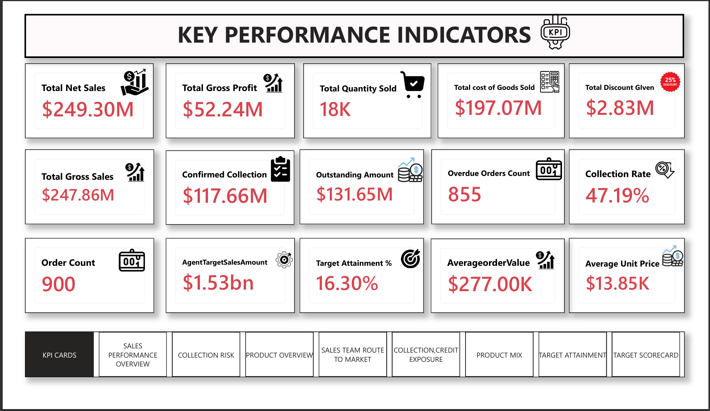
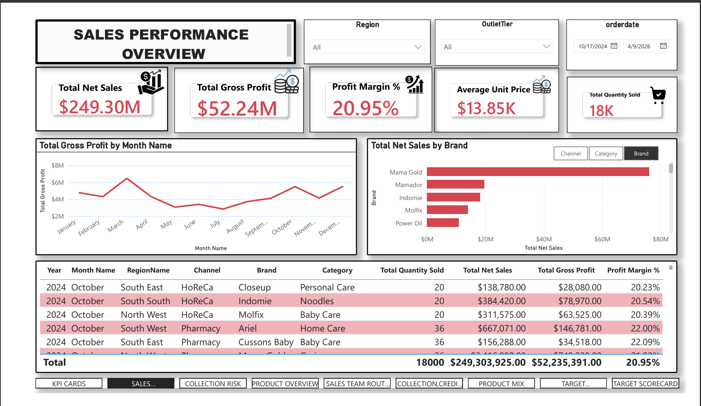

# Sales-Performance-Business-Intelligence-Dashboard
An end-to-end Power BI project built on the DataIT_FMCG dataset for the Full-stack Data Analyst (SQL + Power BI) program at DataIT Academy. The report follows a Nigerian FMCG distributor from sales through delivery to cash collection, and tests performance against targets.

### Comprehensive Sales, Collection Risk, Product Performance and Target Attainment Analysis

## 1. Project Overview

This project presents an interactive Business Intelligence dashboard developed to provide a comprehensive overview of an organization's sales operations, financial performance, collection efficiency, product distribution and sales team effectiveness.

The dashboard transforms raw sales and collection data into meaningful business insights through interactive KPI cards, charts, tables, trend analysis and performance scorecards.

It is designed to help business stakeholders, management teams and decision-makers monitor key performance indicators (KPIs), identify operational challenges, evaluate sales performance and make data-driven decisions.

The analysis covers nine major dashboard sections:

1. KPI Cards
2. Sales Performance Overview
3. Collection Risk Overview
4. Product and Outlet Performance
5. Sales Team, Route to Market and Geographic Execution
6. Collection and Credit Exposure
7. Product Mix
8. Target Attainment
9. Target Scorecard

## 2. Project Objectives

The primary objectives of this project are to:

- Evaluate overall sales performance and revenue generation.
- Measure gross profit and profit margins.
- Monitor product sales volumes and pricing performance.
- Assess collection efficiency and outstanding payments.
- Identify overdue orders and potential collection risks.
- Analyze sales performance across geographical regions and distribution channels.
- Evaluate product performance across different categories, manufacturers and outlet tiers.
- Measure sales team performance against assigned targets.
- Identify gaps between actual sales performance and business targets.
- Provide management with actionable insights for strategic decision-making.

## 3. Dashboard Structure and Page-by-Page Analysis

### Page 1: KPI Cards

The KPI Cards page provides an executive-level summary of the organization's overall business performance.
It presents the most important financial and operational indicators in a single view, allowing management to quickly understand the company's performance.

**Key Performance Indicators:**

| KPI | Reported Value |
|---|---:|
| Total Net Sales | $249.30M |
| Total Gross Profit | $52.24M |
| Total Quantity Sold | 18K |
| Total Cost of Goods Sold | $197.07M |
| Total Discount Given | $2.83M |
| Total Gross Sales | $247.86M |
| Confirmed Collection | $117.66M |
| Outstanding Amount | $131.65M |
| Overdue Orders Count | 855 |
| Collection Rate | 47.19% |
| Order Count | 900 |
| Agent Target Sales Amount | $1.53bn |
| Target Attainment | 16.30% |
| Average Order Value | $277.00K |
| Average Unit Price | $13.85K |

**Key Observations:**

- Total net sales reached approximately $249.30 million.
- Gross profit stood at approximately $52.24 million.
- The business recorded 18,000 units sold across 900 orders.
- Confirmed collections accounted for $117.66 million.
- Outstanding payments amounted to $131.65 million.
- The overall collection rate was 47.19%.
- Agent target attainment was 16.30%.

The KPI page provides a quick understanding of the organization's financial position and highlights areas that require further investigation, particularly outstanding payments and target attainment.

### Page 2: Sales Performance Overview

The Sales Performance Overview page focuses on revenue generation, profitability and sales distribution.
It provides interactive filters for Region, Outlet Tier and Order Date, allowing users to investigate performance across different business dimensions.

**Key Visualizations:**

- Total Net Sales
- Total Gross Profit
- Profit Margin Percentage
- Average Unit Price
- Total Quantity Sold
- Monthly Gross Profit Trend
- Net Sales by Brand
- Detailed Sales Performance Table

**Key Findings:**

**1. Revenue Performance**

Total net sales amounted to approximately $249.30 million, demonstrating the overall revenue generated during the reporting period.

**2. Profitability**

Total gross profit reached approximately $52.24 million, with a reported profit margin of 20.95%.

This indicates that gross profit represents approximately 20.95% of reported net sales.

**3. Monthly Gross Profit Trend**

The monthly trend visualization reveals fluctuations in gross profit throughout the reporting period.

March recorded one of the strongest monthly performances, while July showed a relatively weaker result.

The trend analysis helps identify periods of stronger profitability and months that may require further investigation.

**4. Brand Performance**

Mama Gold emerged as the leading brand by net sales, with a substantial gap between its contribution and the other brands displayed.

Other notable brands include:
- Mamador
- Indomie
- Molfix
- Power Oil

This visualization helps management identify leading brands and evaluate opportunities to improve the performance of other products.

### Page 3: Collection Risk Overview

The Collection Risk Overview page examines the organization's ability to recover payments from customers and outlets.

It focuses on confirmed collections, outstanding balances, overdue orders and collection efficiency.

**Key Performance Indicators:**

| KPI | Reported Value |
|---|---:|
| Confirmed Collection | $117.66M |
| Outstanding Amount | $131.65M |
| Overdue Orders Count | 855 |
| Collection Rate | 47.19% |

**Key Visualizations:**

- Outstanding Amount by Channel
- Outstanding Amount by Business Name
- Confirmed Collection by Business
- Overdue Orders by Business

**Key Findings:**

**1. Outstanding Financial Exposure**

The business recorded approximately $131.65 million in outstanding payments.

This represents 52.81% of total net sales, indicating that more than half of reported sales value remained outstanding at the reporting level.

**2. Collection Efficiency**

The collection rate stood at 47.19%, meaning that less than half of the reported sales value had been collected.

**3. Channel-Level Collection Risk**

The outstanding amount is distributed across five major channels:

- Pharmacy: 23.7%
- HoReCa: 21.5%
- Retail: 20.09%
- Wholesaler: 17.8%
- Supermarket: 16.9%

Pharmacy contributes the largest share of outstanding payments in the displayed channel breakdown.

**4. Business-Level Risk Identification**

The business-level table provides detailed information about outstanding balances, confirmed collections and overdue orders.

This allows management to identify outlets with significant unpaid balances and prioritize collection follow-ups.

### Page 4: Product and Outlet Performance

This page evaluates product performance across different product categories, outlet tiers and manufacturers.

It helps the business understand which products contribute most to revenue and how sales are distributed across the market.

**Key Visualizations:**

- Total Net Sales by Category
- Total Net Sales by Outlet Tier
- Total Net Sales by Manufacturer
- Category Sales Distribution
- Product Performance KPIs

**Key Findings:**

**1. Category Performance**

Grains recorded the highest net sales contribution at approximately $76 million.

Other leading categories include:

| Product Category | Approximate Net Sales |
|---|---:|
| Grains | $76M |
| Cooking Essentials | $30M |
| Beverages | $34M |
| Noodles | $18M |
| Baby Care | $16M |
| Home Care | $16M |
| Condiments | $11M |
| Canned Foods | $11M |
| Dairy | $9M |
| Pharma OTC | $8M |

The displayed category breakdown identifies Grains as the leading category, followed by Beverages and Cooking Essentials.

**2. Outlet Tier Performance**

Sales are distributed across four outlet tiers:

- Tier 3: 30.11%
- Tier 2: 28.39%
- Tier 1: 22.76%
- Tier 4: 18.73%

Tier 3 contributes the largest share of net sales in the displayed distribution.

**3. Manufacturer Performance**

Tropical General Investments (TGI) leads the manufacturer sales ranking with approximately $76 million.

Other manufacturers include:
- Dufil Prima
- PZ Wilmar
- Hayat Kimya
- Rite Foods
- Nestlé Nigeria
- Procter & Gamble
- Unilever
- Power Foods

These insights can support product portfolio decisions, manufacturer performance reviews and sales distribution strategies.

### Page 5: Sales Team, Route to Market and Geographic Execution

This page examines sales performance across geographical regions, distribution channels, stock points, fulfillment types and route-to-market structures.

It provides insights into how the sales organization performs across different territories and distribution networks.

**Key Visualizations:**

- Net Sales by Stock Point
- Net Sales by Performance Band
- Net Sales by Region
- Net Sales by Channel
- Net Sales and Profit Margin by Route to Market
- Profit Margin by Channel
- Profit Margin by Fulfillment Type
- Net Sales by Fulfillment Type

**Key Findings:**

**1. Regional Sales Performance**

| Region | Approximate Net Sales |
|---|---:|
| North West | $82M |
| South East | $58M |
| South West | $51M |
| South South | $35M |
| North Central | $23M |

North West recorded the highest sales contribution, followed by South East and South West.

North Central recorded the lowest contribution among the displayed regions.

**2. Channel Performance**

The channel breakdown shows the following approximate net sales:

- Pharmacy: $45M
- Wholesaler: $43M
- HoReCa: $32M
- Supermarket: $32M
- Retail: $29M

Pharmacy generated the highest sales contribution among the displayed channels.

**3. Profit Margin by Channel**

The wholesale channel recorded the highest displayed profit margin at 24.25%, followed by Pharmacy at 22.56%.

HoReCa recorded 20.83%, Retail 19.00% and Supermarket 16.99%.

This suggests that sales volume and profitability should be evaluated together when assessing channel performance.

**4. Fulfillment Performance**

Self-pickup recorded a profit margin of 21.19%, compared with 21.07% for delivery.

Delivery generated a larger total sales value, approximately $0.19bn, compared with $0.06bn for self-pickup.

### Page 6: Collection and Credit Exposure

This page focuses on order fulfillment, payment status, delivery performance and outstanding financial exposure.

It provides management with a deeper understanding of the organization's collection and credit position.

**Key Performance Indicators:**

| KPI | Reported Value |
|---|---:|
| Delivered Orders | 405 |
| Pending Payment | $10.64M |
| Reversed Amount | $11.12M |
| Late Delivery Rate | 25.00% |
| On-Time Delivery Rate | 75.00% |

**Key Visualizations:**

- Outstanding Amount by Region
- Outstanding Amount by Agent
- Collection Status by Payment Method
- Regional Outstanding Exposure

**Key Findings:**

**1. Order Delivery Performance**

The dashboard records 405 delivered orders.

The delivery performance indicators show that 75% of deliveries were completed on time, while 25% were classified as late.

**2. Payment Exposure**

Pending payments amounted to approximately $10.64 million, while reversed amounts stood at approximately $11.12 million.

These figures provide visibility into payment-related issues that may require operational follow-up.

**3. Regional Credit Exposure**

North West recorded the highest displayed regional outstanding exposure at approximately $13 million.

South West and South East followed at approximately $10 million each.

**4. Agent-Level Exposure**

The agent-level visualization identifies sales representatives associated with outstanding balances.

Grace Okafor appears as the leading agent by outstanding amount in the displayed ranking.

This provides an opportunity to strengthen agent-level accountability and collection monitoring.

**5. Payment Method Analysis**

The payment method table compares confirmed, pending and reversed transactions across:

- Cash
- POS
- Transfer
- Wallet

Cash recorded the highest confirmed collection value among the displayed payment methods.

The table also provides a consolidated view of payment performance.

### Page 7: Product Mix

The Product Mix page uses a Sankey-style visualization to examine how net sales are distributed across different product dimensions.

It provides a hierarchical view of sales movement from the overall sales value into packaging formats, pack sizes and distribution channels.

**Key Dimensions:**

- UOMBase
- PackSize
- Channel

**Key Findings:**

Total net sales amounted to approximately $249.30 million.

The displayed unit-of-measure breakdown shows:

| UOM Base | Net Sales |
|---|---:|
| Carton | $113.92M |
| Bag | $80.18M |
| Pack | $55.21M |

The Pack segment is further broken down by pack size.

The 50s pack size contributes approximately $5.13 million, distributed across several channels:

- Pharmacy
- Wholesaler
- Supermarket
- Retail
- HoReCa

This visualization helps management understand product configuration preferences and how product formats contribute to sales across different channels.

### Page 8: Target Attainment

The Target Attainment page evaluates how effectively the sales organization performs against assigned sales targets.

It combines sales attainment, collection attainment, collection gaps and team-level performance indicators.

**Key Performance Indicators:**

| KPI | Reported Value |
|---|---:|
| Agent Sales Attainment | 16.30% |
| Agent Target Sales Amount | $1.53bn |
| Collection Gap | -$1.11bn |
| Agent Order Target | 29K |

**Key Visualizations:**

- Collection Gap by State
- Agent Sales Attainment, Profit Margin and Outstanding Amount by Team Lead
- Agent Sales Attainment and Collection Attainment by Month

**Key Findings:**

**1. Overall Agent Target Attainment**

Agent sales attainment stands at 16.30%.

This indicates a substantial gap between actual sales performance and the assigned agent sales target.

**2. Team Lead Performance**

The dashboard compares four team leads:

- Bola Adebayo
- Kehinde Adeyemi
- Musa Abdallah
- Ngozi Nwankwo

Ngozi Nwankwo recorded the highest displayed agent sales attainment at 20.18%.

Kehinde Adeyemi recorded 15.54%, Musa Abdallah 13.41% and Bola Adebayo 12.91%.

**3. Monthly Attainment Trends**

The monthly trend compares agent sales attainment with collection attainment between October 2024 and April 2026.

The visualization shows fluctuations in both indicators throughout the reporting period.

Agent sales attainment generally remains above collection attainment in the displayed monthly trend.

**4. Collection Gap by State**

The dashboard displays negative collection gaps across Kaduna, Oyo, Lagos, Ogun and Rivers.

This indicates that the collection gap is a significant area requiring management attention.

### Page 9: Target Scorecard

The Target Scorecard provides a consolidated performance assessment across sales channels, team leads and geographical regions.

It allows management to compare revenue, sales attainment, profitability and collection efficiency across different business segments.

**Key Performance Dimensions:**

- Total Net Sales
- Sales Attainment Percentage
- Profit Margin Percentage
- Confirmed Collection
- Outstanding Amount
- Outstanding Percentage of Sales
- Collection Rate

**Channel-Level Findings:**

| Channel | Net Sales | Collection Rate |
|---|---:|---:|
| HoReCa | $44.90M | 36.96% |
| Pharmacy | $58.08M | 46.27% |
| Retail | $44.68M | 40.81% |
| Supermarket | $45.89M | 51.51% |
| Wholesaler | $55.76M | 57.96% |

Wholesaler recorded the highest collection rate at 57.96%, while HoReCa recorded the lowest at 36.96%.

Pharmacy generated the highest net sales at approximately $58.08 million.

**Team Lead Performance:**

| Team Lead | Net Sales | Sales Attainment |
|---|---:|---:|
| Bola Adebayo | $19.15M | 12.91% |
| Kehinde Adeyemi | $76.57M | 15.54% |
| Musa Abdallah | $50.83M | 13.41% |
| Ngozi Nwankwo | $102.76M | 20.18% |

Ngozi Nwankwo recorded the highest sales value and sales attainment among the four displayed team leads.

**Regional Performance:**

The regional scorecard highlights the following:

- North Central: $36.89M
- North West: $33.09M
- South East: $56.33M
- South South: $46.43M
- South West: $76.57M

South West recorded the highest net sales contribution among the displayed regions.

The scorecard enables management to identify high-performing and underperforming business segments and establish more focused improvement strategies.

## 4. Overall Business Insights

The combined dashboard reveals several important business findings.

### 1. Strong Revenue Generation but Low Collection Efficiency

The organization generated approximately $249.30 million in net sales, but confirmed collections amounted to only $117.66 million.

The resulting collection rate of 47.19% highlights the need to strengthen payment recovery processes.

### 2. Significant Outstanding Financial Exposure

Outstanding payments reached approximately $131.65 million.

This represents a substantial portion of reported net sales and may create cash flow challenges if collection activities are not strengthened.

### 3. Uneven Regional Performance

North West leads the regional sales breakdown on the route-to-market page, while South West leads the regional scorecard.

These differences highlight the importance of examining the underlying filters and aggregation levels before making regional performance decisions.

### 4. Product Concentration

Grains and other leading product categories account for a substantial share of revenue.

The organization should continue monitoring product category contributions and evaluate opportunities to improve the performance of lower-contributing categories.

### 5. Channel Profitability Differences

Wholesale and Pharmacy demonstrate relatively strong profit margins.

Supermarket has the lowest displayed channel profit margin at 16.99%.

This suggests that channel-level pricing, distribution costs and product mix deserve further investigation.

### 6. Sales Target Attainment Requires Improvement

Agent sales attainment stands at 16.30%.

The target attainment analysis indicates that actual performance remains considerably below the assigned sales target.

### 7. Delivery Performance

The dashboard records a 75% on-time delivery rate and a 25% late delivery rate.

Reducing late deliveries could improve customer satisfaction and operational efficiency.

## 5. Business Recommendations

Based on the dashboard findings, the following actions are recommended:

**1. Strengthen Collection Management**

- Prioritize outlets with high outstanding balances.
- Introduce structured collection follow-up procedures.
- Monitor overdue accounts regularly.
- Establish clear collection targets for sales representatives.

**2. Improve Sales Target Attainment**

- Review individual and team sales targets.
- Identify underperforming territories.
- Monitor monthly sales attainment.
- Provide targeted support to sales teams.

**3. Optimize Product Portfolio**

- Maintain the performance of high-revenue categories.
- Investigate opportunities in lower-performing categories.
- Monitor product demand across outlet tiers.
- Evaluate product distribution across channels.

**4. Improve Regional Sales Execution**

- Investigate the reasons behind regional performance differences.
- Strengthen sales activities in lower-performing territories.
- Review stock availability and distribution efficiency.
- Monitor stock point performance.

**5. Improve Delivery Efficiency**

- Investigate the causes of late deliveries.
- Monitor fulfillment performance.
- Review delivery processes and operational bottlenecks.
- Work toward reducing the 25% late delivery rate.

**6. Strengthen Credit Risk Monitoring**

- Establish credit monitoring procedures.
- Regularly review customer outstanding balances.
- Monitor payment reversals and pending payments.
- Set appropriate credit limits based on customer payment history.

## 6. Tools and Technologies

The screenshots demonstrate an interactive Business Intelligence dashboard with KPI cards, slicers, analytical charts, detailed tables and page navigation.

The exact software and data-processing technologies are not identifiable from the screenshots alone.

The project documentation can be extended to include the actual tools used for:

- Data extraction
- Data cleaning and transformation
- Data modeling
- DAX calculations or equivalent measures
- Data visualization
- Dashboard development

## 7. Conclusion

This Sales Performance and Business Intelligence Dashboard provides a comprehensive view of organizational performance by combining sales analysis, profitability monitoring, collection management, product performance, geographical execution and target evaluation.

One of the most important findings is the difference between revenue generation and actual payment collection. Despite generating approximately $249.30 million in net sales, the organization recorded a collection rate of 47.19%, with outstanding payments of approximately $131.65 million.

The dashboard also highlights differences in regional performance, channel profitability, product contributions and sales team target attainment.

By bringing these business indicators together in one interactive reporting environment, the project demonstrates how data analytics and business intelligence can support better financial monitoring, operational control and strategic decision-making.

**Overall, the dashboard transforms business data into actionable insights, helping management understand not only how much the organization sells, but also how effectively it collects revenue, distributes products and achieves its business targets.**

---

## 8. Project Disclaimer and Data Validation Notes

The figures and observations in this documentation are based on the dashboard screenshots provided.

Before using the report for formal financial decisions, the following should be validated against the underlying data model:

- The dashboard displays total net sales of $249.30M and total gross sales of $247.86M. Their definitions and calculation logic should be reviewed.
- The overall target attainment KPI displays 16.30%, while the channel scorecard displays a total channel sales attainment of 26.37%. These appear to represent different calculations and should be clearly distinguished.
- The date slicer displays October 17, 2024 to April 9, 2026. The reporting period and treatment of incomplete months should be confirmed.
- The monthly gross profit chart and the other sales visualizations should be checked for consistent date filters.
- Regional and channel figures should be interpreted using their respective aggregation and filter contexts.
- Currency units and the distinction between sales, collections, outstanding balances and reversed payments should be documented.

These checks will help ensure that the published analysis accurately reflects the underlying business data.
